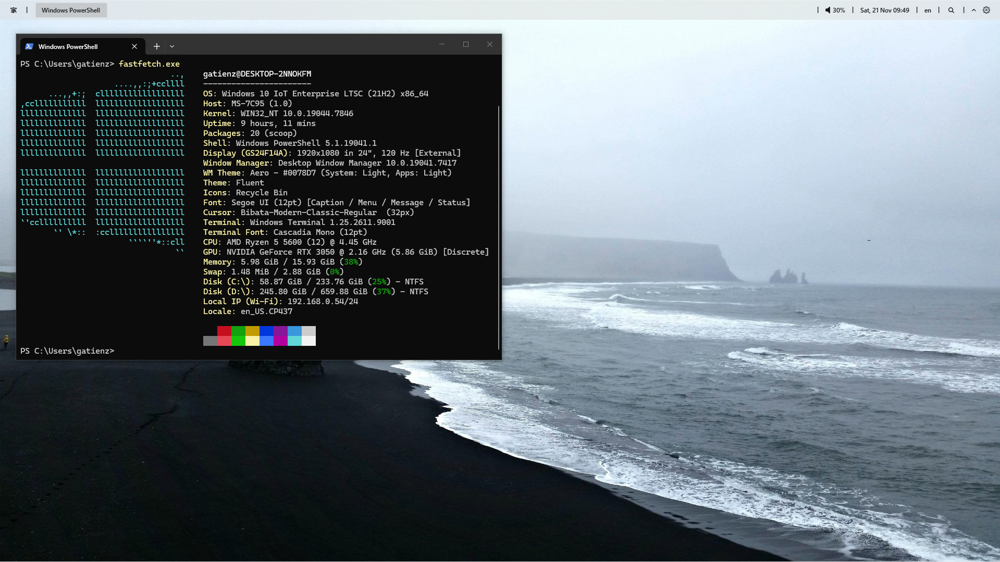

# windows_rice

## yasb
it is a modified Kirakira. https://github.com/MrDLingters/Kirakira_YASB

## scoop

The scoop.sh is a core of my windows setup.

## QoL

Remove Defender with Group Policy

Computer Configuration -> Administrative Templates -> Windows Components -> Microsoft Defender Antivirus

Add a registrt entry do disable annoying popup of gamebar that you do not even have installed.

   